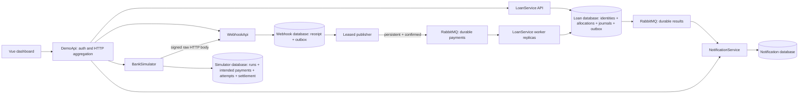

# Architecture and reliability

Each service has a distinct PostgreSQL role/database. PUBLIC connect is revoked; only that owner is granted access. Shared libraries contain event contracts, auth, observability and outbox/failed-message plumbing, not financial domain entities or a generic domain repository. The BFF reads service APIs; it never queries their databases. Financial allocation is entirely local to one LoanService transaction.

**Durable receipt vs eventual application.** Signature/schema validation precedes a local receipt/outbox transaction. HTTP 200 only acknowledges durable receipt. PostgreSQL failure returns retryable 503. RabbitMQ is outside that transaction, so the receiver remains useful through broker outages.

**At least once with idempotent effects.** Outbox instances claim rows using SKIP LOCKED and recoverable 30-second leases. Persistent mandatory publishes await publisher confirms; rows are marked published afterward. Backoff/jitter retries remain durable. A process crash or expired lease can publish twice. LoanService advisory-locks bank/transaction identity, takes the loan row lock, then commits processing outcome, allocation, balance, journal and result outbox together. RabbitMQ ACK follows commit. Redelivery after commit returns the existing result. Event identity dedup in WebhookApi is independent of transaction identity dedup in LoanService. Immutable-field conflicts become visible review records.

**Bounded work.** Worker consumers process one message at a time per replica with prefetch eight. Infrastructure errors use durable TTL retry queues of 5/15/60 seconds, then the failed queue. A second consumer persists failed envelopes for operators. Unknown references are business outcomes, not automatic infinite retries. Resolution adds an audited mapping while retaining the original payload/reference. Admin replay returns prior applied outcomes and audits within the financial transaction. Notification dedup and record creation are atomic.

**Simulator ownership.** Run start commits the definition and all intended bank transactions before sending. A database-serialized start rejects a second active run. A dedicated PostgreSQL session advisory lock owns generation across replicas; restart resumes unfinished planned copies with original identities. Scheduling is paced independently of HTTP responses, with a bounded task set. Retries record actual attempts and respect Retry-After, with exponential jittered delays. Missing Webhook persists successful bank transactions while skipping delivery. Redelivery signs a fresh delivery timestamp over the unchanged body.

**Observability and access.** Structured JSON logs exclude request bodies/secrets/signatures. HTTP correlation IDs and W3C trace context pass through events; OpenTelemetry can export to Jaeger. Prometheus scrapes actual in-process counters/histograms. RabbitMQ management provides real queue/consumer/rate values. Kubernetes telemetry uses a namespace-scoped read-only role and trusted service-account CA; responses exclude pod specs and credentials. Unavailable data stays null and is labelled. CPU HPA controls receiver resources while KEDA queue length controls workers; no independent worker HPA competes with KEDA.

Tradeoffs: scheduled interest recognition follows eligible processing; bank paidAt controls installment eligibility while application order is serialized at the financial boundary; demo login uses a short-lived HMAC-signed local session instead of an identity provider. Broker/database are single instances. Receiver CPU, worker throughput, pool connections and simulator scheduling all contend for one Docker Desktop machine.
